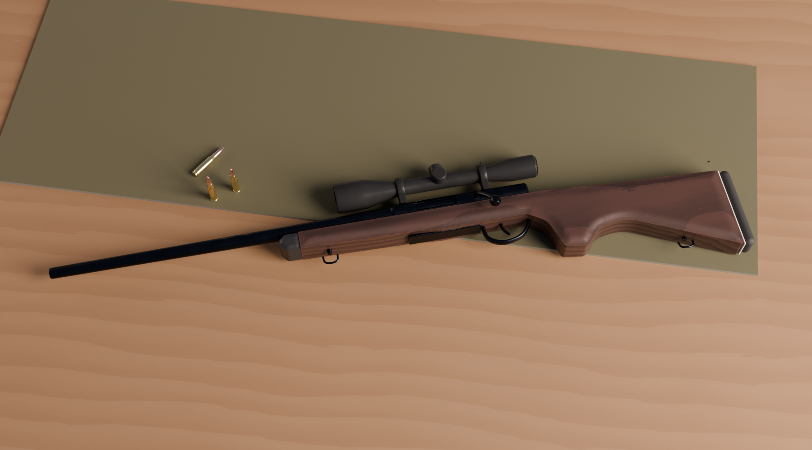
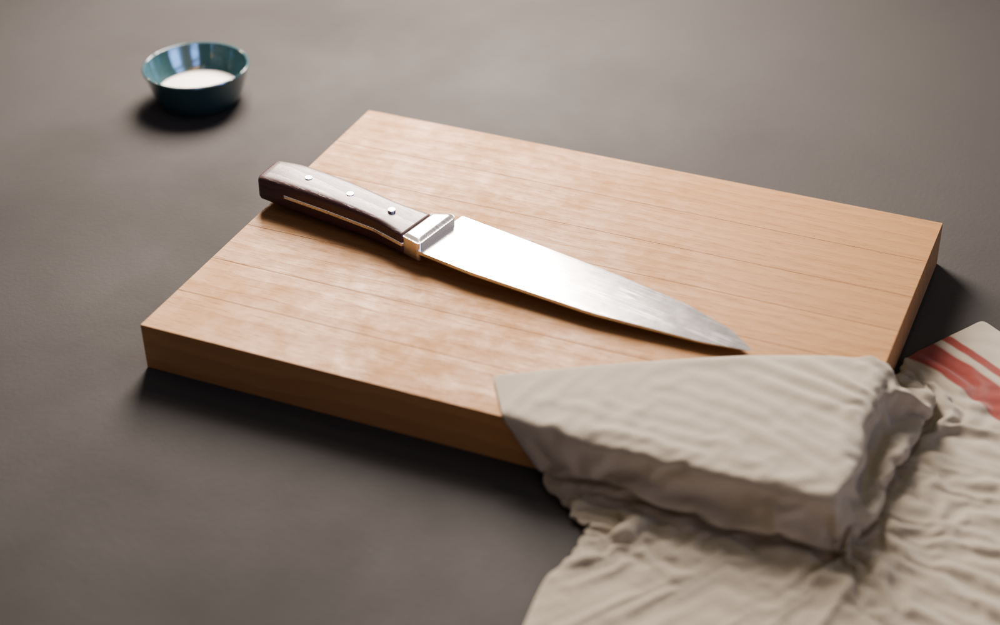
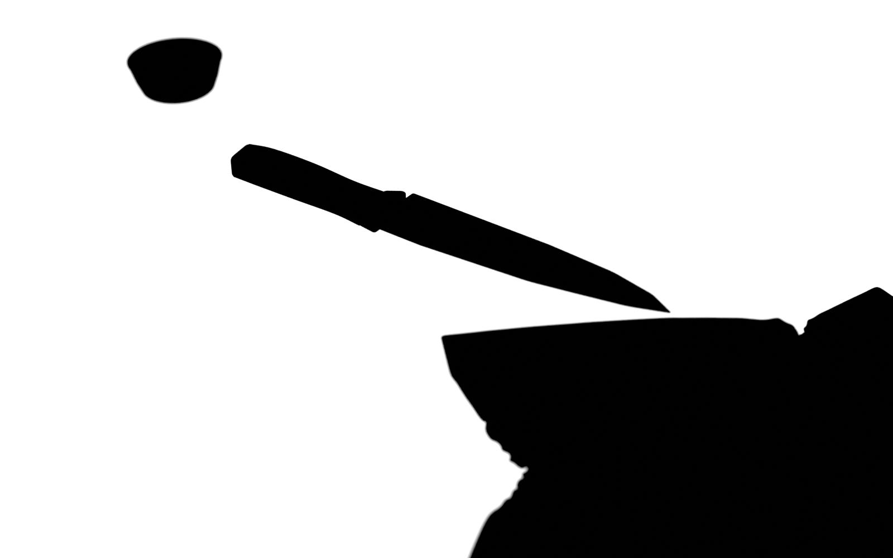
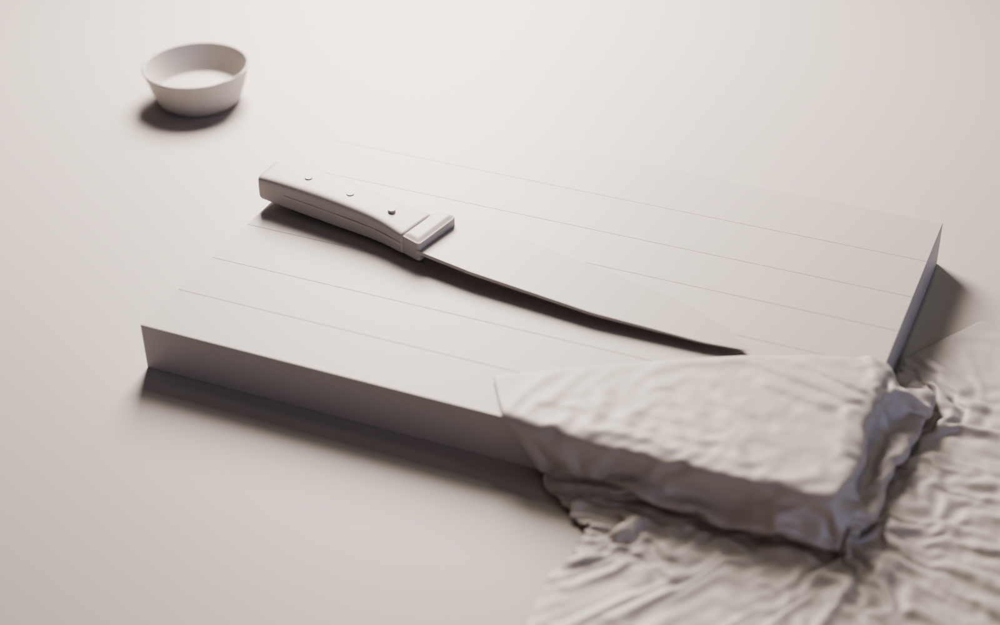

# bluerskill

**Anti-slop 3D for Blender.** [taste-skill](https://github.com/growing7696-cmyk/taste-skill-v3)이 웹 페이지의 AI티를 없앤다면, bluerskill은 Claude Code가 만드는 **3D 모델링·렌더의 AI티**를 없앱니다.

| 흔한 AI식 bpy 출력 — audit **0/100** | bluerskill — audit **100/100** |
|---|---|
|  |  |

같은 요청("다이너 머그컵 정물")을 두 방식으로 만든 결과입니다. 재현: [`examples/mug_still_life.py`](skills/bluerskill/examples/mug_still_life.py)

### 모델링: 도형 쌓기가 아니라 실제로 만들기

AI 3D는 재질이나 조명 전에 **형태**에서 무너집니다. 큐브와 실린더를 대충 쌓기 때문입니다. bluerskill은 치수표를 먼저 쓰고, 실루엣을 그리고, 실제 제작 방식(톱으로 켜기, 선반 가공, 휜 막대, 기계 가공 블록)에 맞는 빌더로 부품을 만듭니다.

| 첫 시도 (개선 전 스킬) | 개선된 스킬 |
|---|---|
|  |  |

| 실루엣: 검은 단색으로도 알아볼 수 있는가 | 클레이: 재질 없이도 형태가 서는가 |
|---|---|
|  |  |

부품 35개로 된 볼트액션 소총 예제입니다. 재현: [`examples/rifle_prop.py`](skills/bluerskill/examples/rifle_prop.py)

### 표면·반사·렌더 검사: "점수는 100인데 여전히 CG 같은" 문제

위 소총은 씬 감사(`audit.py`)에서 **100점**을 받았지만 렌더는 여전히 밋밋했습니다. 표면이 수학적으로 매끈하고, 금속은 반사할 게 없어 회색 플라스틱처럼 보이고, 하이라이트가 없는 뿌연 사진이었기 때문입니다. 감사가 너무 관대했던 것입니다. 그래서 두 가지를 더했습니다.

- **씬 감사 강화**: 모든 재질에 표면 요철이 없으면(M10), 금속·광택이 단색 배경만 반사하면(L7) 감점합니다.
- **렌더 픽셀 검사 `look.py`**: 렌더된 이미지 자체를 측정합니다. 하이라이트 클리핑, 뿌연/물 빠진 톤, 중간톤만 있는 화면, 피사체와 배경 분리, 피사체 하이라이트 유무, 구도를 0–100점으로 채점합니다. `preview.py`가 beauty 렌더 후 자동 실행합니다.

| v2 — 예전 audit 100 → 새 audit 85, look 88 (하이라이트 없음, 중간톤 94 %) | v3 — 같은 모델 + 표면 요철·HDRI 반사·판재 작업대·조명/카메라 수정: audit 100, look 98 |
|---|---|
|  |  |

### 유기적 형태와 천: loft, drape

손으로 깎거나 자란 형태(손잡이, 그립, 과일)는 단면이 길이를 따라 바뀌므로 `loft`로, 천은 평면에 천 텍스처를 붙이는 대신 `drape`로 실제로 떨어뜨려 접히게 만듭니다. 날은 옆모습을 뽑은 뒤 날 쪽으로 갈수록 얇게 갈아내고, 도마는 붙인 스트립마다 톤이 다르고, 리넨 타월은 직조 요철과 짜 넣은 줄무늬가 주름을 따라갑니다.



| 실루엣 | 클레이 |
|---|---|
|  |  |

재현: [`examples/knife_board.py`](skills/bluerskill/examples/knife_board.py)

## 설치

```bash
npx skills add growing7696-cmyk/bluerskill
```

전역 설치(모든 프로젝트에서 사용):

```bash
npx skills add growing7696-cmyk/bluerskill -g
```

필요한 것: [Node.js](https://nodejs.org), [Git](https://git-scm.com), [Claude Code](https://claude.com/claude-code), Blender 4.2 이상(5.x 권장)이 `PATH`에 있을 것.

> `Error: spawn git ENOENT`가 나오면 Git이 없는 것입니다. Windows는 `winget install --id Git.Git -e`로 설치한 뒤 터미널을 새로 열고 다시 실행하세요. [blender-mcp](https://github.com/ahujasid/blender-mcp)가 연결돼 있으면 열려 있는 Blender에서 실시간으로 작업합니다.

## 무엇을 하나

3D가 "AI가 만든 것처럼" 보이는 이유는 웹과 같습니다. 모든 게 기본값이고, 모든 게 완벽하고, 아무것도 역사가 없습니다. bluerskill은 기본값을 **결정**으로, 완벽함을 **그럴듯한 불완전함**으로 바꿉니다.

- **헤더와 다이얼**: 작업 전에 구체적 레퍼런스와 `WEAR / STYLIZATION / CLUTTER` 다이얼을 정합니다.
- **모델링 규칙**: 치수표 → 실루엣 → 제작 방식에 맞는 빌더 선택(켜기·선반·휜 막대·손으로 깎기·천) → 큰/중간/작은 형태 순서. 기본 도형을 그대로 조립하는 것은 금지입니다.
- **필수 규칙 12개**: 베벨 없는 날카로운 모서리 금지, 실제 크기, 떠 있는 물체 금지, 기본 회색 재질 금지, 균일한 거칠기 금지, 시작 카메라·조명 금지, AgX 색 관리, 복제품 변화, 렌더를 직접 보고 확인(씬 + 픽셀 검사), 기본 도형 조립 금지, 매끈한 표면 금지(제작 방식에 맞는 요철), 반사할 환경 없는 금속 금지.
- **표면 요철**: 나뭇결 기공, 오렌지필 도장, 주조, 망치 자국, 가죽, 천 직조, 손때 스크래치를 실제 크기(미터)로 넣습니다.
- **반사 환경**: Blender에 들어 있는 HDRI를 써서 다운로드 없이 금속·유약이 방을 반사하게 합니다.
- **기본 금지 룩**: 어두운 배경의 네온 보라·청록 조명, 그라데이션 위에 떠 있는 크롬 공, 파스텔 클레이 아이소메트릭 방 등.

## 구성

```
skills/bluerskill/
├── SKILL.md                 # 규칙과 작업 순서
├── reference/
│   ├── modeling.md          # 모델링 플레이북: 치수표, 실루엣, 제작 방식별 빌더, 디테일 단계
│   ├── ai-tells.md          # 3D AI티 카탈로그 (형태·재질·조명·카메라·렌더) + 해결법
│   ├── materials.md         # 실제 재질의 albedo/roughness 표, 얼룩·마모 레시피
│   └── light-camera.md      # 조명 세팅, 색온도, 렌즈·조리개 기준
├── scripts/
│   ├── shapes.py            # 모델링 빌더 (profile_extrude+crown, lathe, sweep, loft, drape, rounded_box, cut, screw)
│   ├── humanize.py          # 마감 라이브러리 (bevel, ground, jitter, 재질 프리셋, 마모, 나뭇결, 표면 요철·직조·스크래치,
│   │                        #   판재 작업대, HDRI 반사, 조명, 카메라)
│   ├── audit.py             # 장면의 AI티를 0–100점으로 채점하고 해결법 출력 (기본 도형 조립·매끈한 표면·죽은 반사 감지)
│   ├── look.py              # 렌더 픽셀을 0–100점으로 채점 (클리핑, 뿌연 톤, 피사체 분리, 하이라이트, 구도)
│   └── preview.py           # silhouette / clay / beauty / wire 확인용 렌더 + 썸네일 + look.py 자동 실행
└── examples/
    ├── mug_still_life.py    # 간단한 장면 before/after
    ├── rifle_prop.py        # 하드서피스 소품 (부품 35개) 모델링 예제
    └── knife_board.py       # 유기적 형태(loft 손잡이) + 천(drape 타월) + 표면 요철 예제
```

스크립트는 단독으로도 쓸 수 있습니다.

```bash
blender -b scene.blend --python skills/bluerskill/scripts/audit.py
blender -b scene.blend --python skills/bluerskill/scripts/preview.py -- --out ./renders --views silhouette,clay,beauty
blender -b --python skills/bluerskill/scripts/look.py -- renders/beauty.png --mask renders/silhouette.png
```

## 한계

- 떠 있는 물체·바닥 유무 검사는 바운딩 박스 기반 추정이라 오탐·누락이 있을 수 있습니다.
- `look.py`의 기준값은 사진의 일반적인 톤 분포에 맞춘 경험치입니다. 하이키·로우키처럼 의도한 스타일은 경고가 나올 수 있으니 한 줄로 이유를 남기면 됩니다.
- 이야기, 형태 리듬, 레퍼런스 충실도는 자동으로 판단할 수 없습니다. 그래서 스킬은 렌더를 직접 열어 보고 고치는 단계를 필수로 둡니다.

## License

MIT
